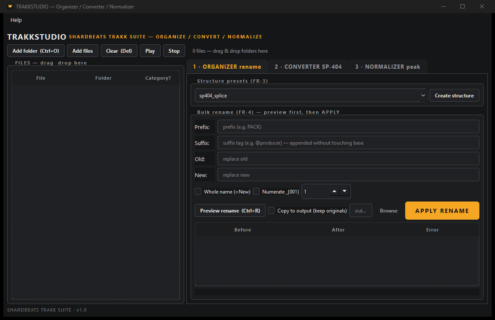

# TRAKKSTUDIO — Multitool (ShardBeats TRAKK SUITE)

> **Organize, convert to SP-404MK2 WAV and peak-normalize a whole sample library in one window.** Three batch tools, three tabs, each with its own START — no forced pipeline.

**[Download for Windows](https://github.com/shardbeats/TRAKKSTUDIO/releases/latest)** · **[All 6 tools](https://shardbeats.github.io/tools/)** · **[Free beat pack (WAV + stems)](https://shardbeats.github.io/landing/)**

<!-- Screenshot: save the image as docs/screenshot.png, then uncomment this block
<p align="center"></p>
-->

Free and open source (MIT). Portable exe or per-user installer, no account, no telemetry — your audio never leaves your computer.


`Folders/files -> Organize (rename) | Convert (SP-404 WAV) | Normalize (peak) -> Mirror output, summary in panel`

3 independent tools in 1 window (files left, tools right). Each tab has its own START/Cancel and its own summary. No forced pipeline.

## Features

| Tool | What it does | Output |
|---|---|---|
| 1 · ORGANIZER rename | Creates `sp404_splice` structure (16 folders), bulk rename with Before→After preview: Clean, Replace Old→New, Whole name (=New), Prefix, Suffix `@tag` append, anti-collision Numerate, in-place by default. Leaves no extra files next to your samples | Summary in panel |
| 2 · CONVERTER SP-404 | Batch to SP-404MK2 WAV: 48kHz (or 44.1k legacy) / 16-bit / stereo PCM; copies if already at target, resamples on Force-to-rate, skips `*_sp.wav` | `*_sp.wav` |
| 3 · NORMALIZER peak | Each clip to its own peak (linear gain, no compression), default -1.0dB ±0.5dB skip, preserves rate/depth, skips `*_N.wav` and silence | `*_N.wav` |
| Shared | Pack-grouped drag&drop scan, local SQLite, Mirror/Flat/Next-to-source folder resolver, disk check, Cancel that kills ffmpeg, amber `#F5A623` theme | `library.db` |

## Requirements

- Windows 10/11 64-bit, ~300MB free + room for copies (`input×1.8 + 100MB`, the app checks before START).
- To install: run `TRAKKSTUDIO-Setup-1.0.exe` (per-user, no admin, with uninstaller).
- To run from source: Python 3.10+ and FFmpeg on PATH (`ffmpeg -version`).
- To use the portable: nothing (the `.exe` bundles Qt + FFmpeg, v1.0 actual: 210MB with FFmpeg full build; ~120MB with essentials). Some antiviruses flag PyInstaller one-file builds as false positive.

## Quick start (4 steps)

1. Double-click `start.bat` (creates `.venv`, installs, opens the GUI). Later runs: `run.bat` (uses the existing `.venv`).
2. First launch: 3-step tour (reopen in Help → Quick tour, F1).
3. Drag your drumkit onto FILES (left).
4. Go to the tab you need → Preview → START. E.g. Tab 1, Old `Closed Hat` New `hhat` → Preview → APPLY.
5. Double-click any row (or Play) to listen; Stop cuts it. Selecting another row auto-cuts the preview.

## Shortcuts

| Shortcut | Action |
|---|---|
| `Ctrl+O` | Add folder |
| `Ctrl+R` | Preview rename (tab 1) |
| `Space` | START / Cancel the visible tab (never while typing) |
| `Del` | Clear file list |
| `F1` | Quick tour |

## Manual setup (devs)

```
python -m venv .venv
.venv\Scripts\python.exe -m pip install -r requirements.txt
.venv\Scripts\python.exe main.py
```

## Usage

1. Add folder/files or drag&drop (if running as Admin, Windows blocks dragging: reopen normally).
2. (Rename only) Tab 1: pick the `sp404_splice` preset → Create structure if you need folders.
3. (Rename only) Tab 1: Prefix/Suffix/Old/New + Whole/Numerate → Preview rename → check After → APPLY (in-place by default; tick Copy only to keep originals in another folder; confirms with a count and warns if you touch ALL with no selection).
4. (Convert only) Tab 2: rate 48000, Force-to-rate ON → Preview actions (`copy/convert/skip`) → START CONVERT.
5. (Normalize only) Tab 3: Target -1.0, Tol 0.5 → START NORMALIZE.
6. Expected result: `Closed Hat (8).wav` → rename `hhat_(8).wav` → convert `hhat_(8)_sp.wav` (48k/stereo) → normalize `hhat_(8)_sp_N.wav` (-1dB). Each step is optional and shows its summary in the panel. Your folders stay clean: zero CSVs or sidecars.
7. The local DB (`%APPDATA%/TRAKKSTUDIO/library.db`) keeps the inventory; it regenerates on every scan.

## Project structure

```
TRAKKSTUDIO/
├── main.py            # entry: GUI by default, CLI with flags
├── gui.py             # 2 columns: FILES left + 3 tabs right
├── organizer.py       # scan/structure/bulk-rename (no FFmpeg)
├── player.py          # audio preview via ffplay (double-click/Play/Stop)
├── converter.py       # TRAKKCONVERTER heritage (SP-404)
├── normalizer.py      # TRAKKNORMALIZER heritage (peak)
├── db.py              # SQLite library.db (stdlib)
├── styles.qss         # heritage amber theme #F5A623
├── build_exe.py       # PyInstaller one-file + bundled ffmpeg
├── start.bat          # setup + launch
├── docs/SRS.md        # frozen spec v1.0
├── tests/             # pytest (generated tones, skip without ffmpeg)
├── README.md / MAINTENANCE.md / CHANGELOG.md
```

## Tests

```
.venv\Scripts\python.exe -m pip install -r requirements-dev.txt
.venv\Scripts\python.exe -m pytest tests -q
```

65 tests: organizer/rename/whole-name/tools/db-scan + guide/playback + ffmpeg e2e (generates tones on the fly, skips without ffmpeg).

## Troubleshooting

| Symptom | Likely cause / fix |
|---|---|
| `Copy mode needs an output folder` | Untick Copy (in-place) or pick an output with Browse |
| Preview changes nothing | `Old` not found: check spaces/dashes/case; the label says how many change |
| `BLOCKED: collision` | Enable Numerate or change New |
| Drag&drop rejected (forbidden cursor) | Running as Admin: reopen normally |
| `ffmpeg not found` (from source) | Install FFmpeg and add it to PATH; the `.exe` doesn't need it |
| Antivirus false positive on the `.exe` | Normal for PyInstaller one-file; build it yourself with `python build_exe.py` |
| SmartScreen "unknown publisher" | Unsigned build: More info → Run anyway |
| Out of space | Free `input×1.8 + 100MB`; START blocks before writing |
| Exe looks white/native | Old build without QSS: use build 2+ (QSS via `--add-data`, see CHANGELOG) |

## Roadmap (where we stand — 2026-11-02)

- [x] **M0 Spec:** SRS v1.0 FROZEN (`docs/SRS.md`).
- [x] **Sprint 1 Engine:** `organizer/converter/normalizer/db` + green pytest.
- [x] **Sprint 2 GUI:** 2 columns, heritage amber theme, in-place rename + Whole name.
- [x] **Build 1:** `dist/TRAKKSTUDIO.exe` 210MB portable (ffmpeg+ffprobe).
- [x] **Build 2:** QSS inside the exe, readable columns (`pack/sub`), zero CSVs, `@producer` placeholder. Pushed + tag `v1.0`.
- [x] **Icon:** option C (3 amber layers), `make_icon.py` + bundled in exe.
- [x] **Installer:** Inno Setup 6 per-user (`TRAKKSTUDIO-Setup-1.0.exe`), smoke-tested.
- [x] **Guide:** window Space router, Help menu (tour/shortcuts/About), first-run tour.
- [x] **Preview:** ffplay audio preview (double-click/Play/Stop, auto-cut on select).
- [x] **Safety:** APPLY confirm with count.
- [x] **MVP tested:** full pass on a second PC (Win10 Pro) — install, scan, convert, normalize, preview, uninstall.
- [x] **Release:** `v1.0` published on GitHub (`TRAKKSTUDIO.exe` + `TRAKKSTUDIO-Setup-1.0.exe` + SHA256).

## License

See `LICENSE` (TRAKK SUITE heritage).

## TRAKK SUITE

Six free, offline tools for beatmakers. They are independent: install only what you need, or run three of them from this one window.

| Tool | What it does |
|---|---|
| **TRAKKSTUDIO** | Organize, convert and normalize in a single window |
| [TRAKKCONVERTER](https://github.com/shardbeats/TRAKKCONVERTER) | Sample libraries → WAV for the Roland SP-404MK2 |
| [TRAKKNORMALIZER](https://github.com/shardbeats/TRAKKNORMALIZER) | Per-clip peak normalization for sample packs |
| [TRAKKNAME](https://github.com/shardbeats/TRAKKNAME) | Beat title generator (EN/ES, 20 moods) |
| [TRAKKOUT](https://github.com/shardbeats/TRAKKOUT) | Beat + artwork → 1080p MP4 for YouTube |
| [TRAKKLICENSE](https://github.com/shardbeats/TRAKKLICENSE) | Beat license contracts as PDF (EN/ES) |

- **Website:** https://shardbeats.github.io/tools/
- **Free beat pack (WAV + stems):** https://shardbeats.github.io/landing/
- **Android version of TRAKKNAME:** https://github.com/shardbeats/TRAKKNAME-IONIC
- **Sound kits:** https://www.beatstars.com/shardbeats/sound-kits

## FAQ

**Is it free?** Yes. MIT licensed, free for personal and commercial use, with no account and no usage limits.

**Do I need Python or FFmpeg installed?** No. The portable `.exe` bundles Qt and FFmpeg. You only need Python 3.10+ and FFmpeg on PATH if you run it from source.

**What does the converter output?** WAV, 48 kHz, 16-bit, stereo PCM by default — the format the SP-404MK2 works with internally. Files already at the target are copied instead of re-encoded.

**How is the normalizer different from a regular normalizer?** It matches every clip to its own peak with linear gain instead of pushing everything up by the same amount, so quiet kicks reach the target without the loud ones clipping.

**Does it work offline?** Yes. Everything is local. Nothing is uploaded.

**Which systems?** Windows 10 and 11, 64-bit.
